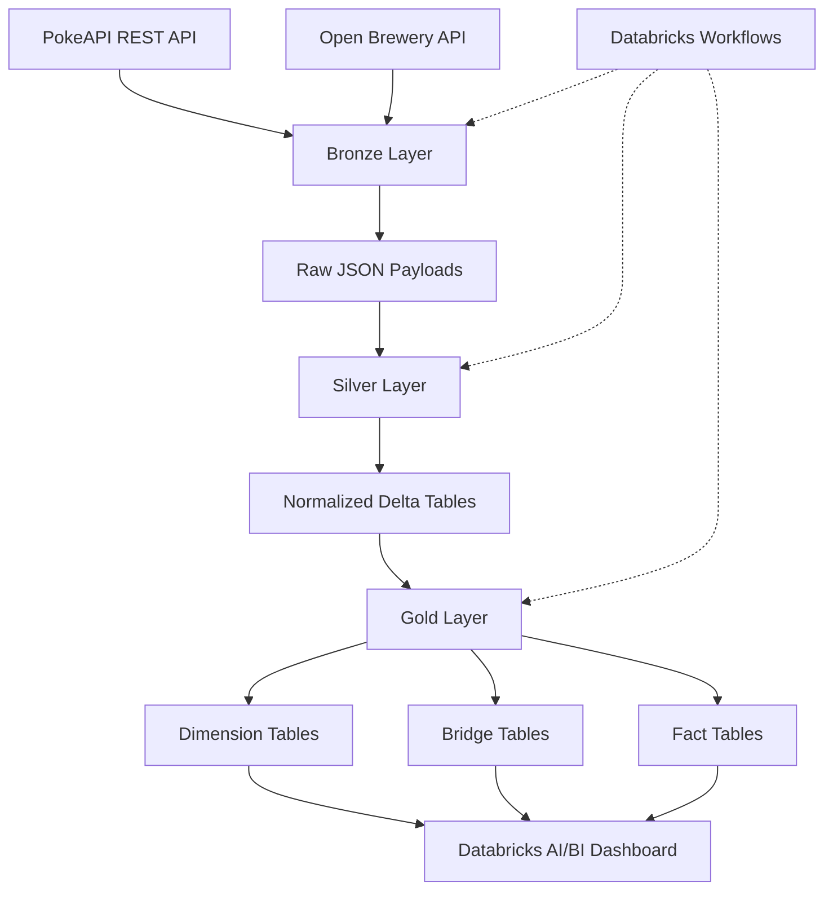
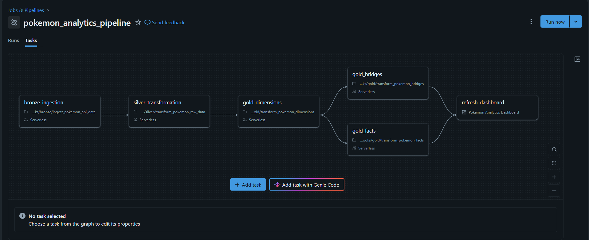
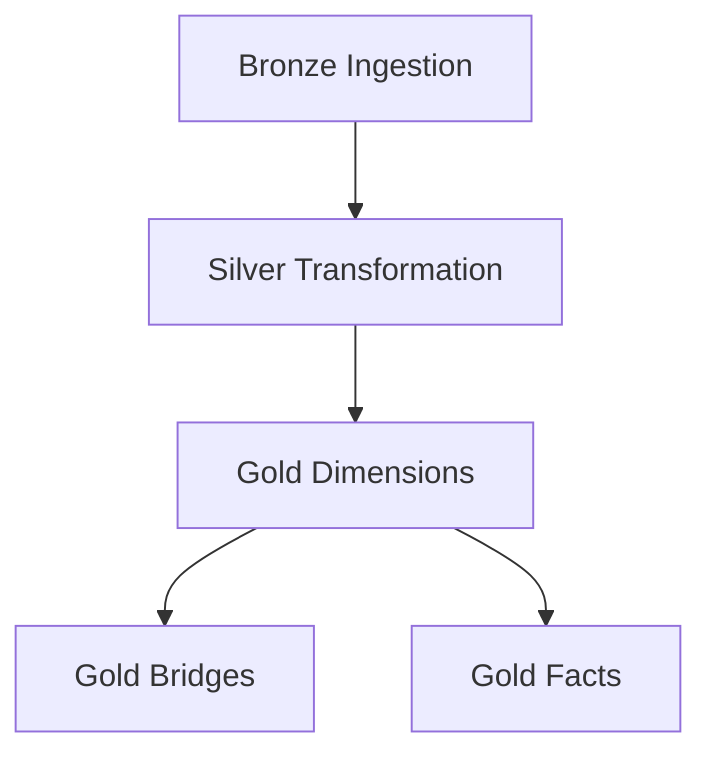
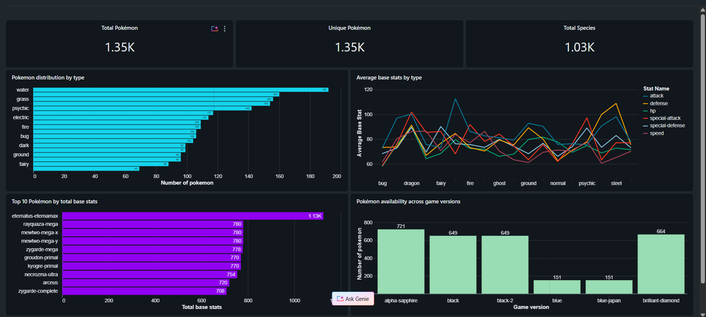

# Pokémon Analytics Platform | End-to-End Data Engineering Project

An end-to-end Data Engineering platform built using **Databricks, PySpark, SQL, Delta Lake, and Python**, designed to ingest Pokémon data from REST APIs, transform raw API responses into analytics-ready datasets, implement dimensional modelling, and deliver insights through an interactive dashboard.

The project demonstrates how to build a scalable data pipeline using the **Medallion Architecture**, implement incremental data processing, manage dimension and fact relationships, and orchestrate multi-stage workflows.

---

## Project Overview

This project transforms raw Pokémon API responses into a structured analytical data platform.

The pipeline follows three major layers:

- **Bronze:** Ingest and retain raw API responses.
- **Silver:** Parse, normalize, and validate nested API data.
- **Gold:** Build a dimensional data warehouse consisting of dimensions, bridge tables, and fact tables.

The resulting Gold layer powers an interactive Databricks AI/BI Dashboard for analyzing Pokémon characteristics, type distributions, battle statistics, and game-version presence.

## Architecture



### Technology Stack

| Component | Technology |
|---|---|
| Language | Python |
| Distributed Processing | PySpark |
| Query Language | Spark SQL |
| Data Platform | Databricks |
| Storage Format | Delta Lake |
| Data Architecture | Medallion Architecture |
| Data Sources | PokeAPI |
| Orchestration | Databricks Workflows |
| Analytics | Databricks AI/BI Dashboards |
| Version Control | Git, GitHub |

---

## Data Pipeline Design

### 1. Bronze Layer – Raw Data Ingestion

The Bronze layer ingests data from REST APIs and persists the original API responses in Delta tables.

**Key implementation details:**

- REST API ingestion using Python.
- Pagination support for retrieving large API datasets.
- Raw JSON payload preservation.
- API request URL and pagination metadata tracking.
- HTTP status code capture.
- Ingestion timestamps and source metadata.
- Delta table storage.

**Bronze table structure:**

| Column | Description |
|---|---|
| raw_payload | Original API response |
| request_url | API request URL |
| offset | Pagination offset |
| limit | Page size |
| status_code | HTTP response status |
| _ingestion_timestamp | Ingestion timestamp |
| _source | Source system |
| _api_endpoint | API endpoint |

Retaining raw API responses provides traceability and allows downstream transformations to be reprocessed without repeatedly calling external APIs.

### 2. Silver Layer – Data Transformation

The Silver layer converts nested JSON responses into structured, normalized Delta tables.

**Key implementation details:**

- JSON parsing using PySpark.
- Schema definition and structured extraction.
- Flattening nested arrays and objects.
- Exploding nested collections into relational datasets.
- Data type standardization.
- Natural key-based deduplication.
- Incremental upsert processing.
- Data quality validation.

The Silver layer contains the following normalized datasets:

| Table | Description |
|---|---|
| pokemon | Core Pokémon attributes |
| pokemon_types | Pokémon-to-type assignments |
| pokemon_abilities | Pokémon abilities |
| pokemon_stats | Base battle statistics |
| pokemon_moves | Pokémon move associations |
| pokemon_move_details | Move learning methods and game-version-group details |
| pokemon_forms | Pokémon forms |
| pokemon_game_indices | Pokémon game-version identifiers |

**Silver layer validation results:**

| Dataset | Records |
|---|---:|
| pokemon | 1,351 |
| pokemon_types | 2,116 |
| pokemon_abilities | 2,943 |
| pokemon_stats | 8,106 |
| pokemon_moves | 99,509 |
| pokemon_move_details | 638,321 |
| pokemon_forms | 1,579 |
| pokemon_game_indices | 25,392 |

The normalized model separates one-to-many relationships instead of storing repeated nested structures in a single wide table.

### 3. Gold Layer – Dimensional Data Warehouse

The Gold layer transforms normalized Silver datasets into an analytics-oriented dimensional model.

It contains:

- 9 dimension tables.
- 3 bridge tables.
- 3 fact tables.

The dimensional model uses surrogate keys to establish relationships between facts, dimensions, and bridges.

#### Dimension Tables

| Dimension | Purpose | Key |
|---|---|---|
| dim_pokemon | Pokémon master attributes | pokemon_key |
| dim_type | Pokémon types | type_key |
| dim_ability | Pokémon abilities | ability_key |
| dim_move | Pokémon moves | move_key |
| dim_form | Pokémon forms | form_key |
| dim_version_group | Move learning version groups | version_group_key |
| dim_learn_method | Move learning methods | learn_method_key |
| dim_game_version | Game versions | game_version_key |
| dim_stat | Battle statistics | stat_key |

**Dimension loading strategies:**

- `dim_pokemon` implements Slowly Changing Dimension Type 2 (SCD Type 2).
- The remaining dimensions use Type 1 upsert logic.

For Pokémon, attribute changes are tracked through historical versions using:

- `effective_from`
- `effective_to`
- `is_current`
- `attribute_hash`

When tracked attributes change, the existing current record is expired and a new version is inserted.

#### Bridge Tables

Bridge tables represent many-to-many relationships between Pokémon and their associated entities.

| Bridge | Relationship |
|---|---|
| bridge_pokemon_type | Pokémon ↔ Types |
| bridge_pokemon_ability | Pokémon ↔ Abilities |
| bridge_pokemon_form | Pokémon ↔ Forms |

These tables resolve many-to-many relationships while maintaining a dimensional model.

#### Fact Tables

| Fact | Grain | Measures / Attributes |
|---|---|---|
| fact_pokemon_stats | One Pokémon per stat | base_stat, effort |
| fact_pokemon_move_learning | One Pokémon-move-version-group-learning combination | level_learned_at, learn_order |
| fact_pokemon_game_presence | One Pokémon per game version | game_index |

**Fact loading strategy:**

- Dimension surrogate keys are resolved during fact preparation.
- Fact records are loaded using Delta Lake MERGE operations.
- Business grain is used to identify records.
- Null-safe matching is applied to nullable grain attributes.
- Duplicate fact records and unresolved dimension references are validated.

The facts represent the current analytical state rather than periodic historical snapshots.

---

## Data Quality and Validation

Data quality checks are implemented throughout the pipeline.

### Silver Layer

- Schema validation.
- Natural key validation.
- Duplicate record detection.
- Null checks.
- Record count reconciliation.
- Nested data parsing validation.

### Gold Layer

- Null surrogate key validation.
- Surrogate key uniqueness.
- Natural key uniqueness.
- Foreign key integrity checks.
- Duplicate fact grain validation.
- SCD Type 2 current-record validation.
- Load timestamp validation.

### Gold Layer Validation Results

| Dataset | Rows |
|---|---:|
| dim_pokemon | 1,351 |
| dim_type | 18 |
| dim_ability | 313 |
| dim_move | 833 |
| dim_form | 1,579 |
| dim_version_group | 26 |
| dim_learn_method | 10 |
| dim_game_version | 46 |
| dim_stat | 6 |
| bridge_pokemon_type | 2,116 |
| bridge_pokemon_ability | 2,943 |
| bridge_pokemon_form | 1,579 |
| fact_pokemon_stats | 8,106 |
| fact_pokemon_move_learning | 638,321 |
| fact_pokemon_game_presence | 25,392 |

**Final validation outcome:** All implemented Gold-layer audits passed, including surrogate key checks, natural key uniqueness, duplicate fact grain checks, null checks, and foreign key integrity.

---

## Workflow Orchestration
### Databricks Workflow


The pipeline is orchestrated using Databricks Workflows.

The job consists of five tasks:

1. `bronze_ingestion`
2. `silver_transformation`
3. `gold_dimensions`
4. `gold_bridges`
5. `gold_facts`

### Workflow Dependency Graph



Gold bridge and fact transformations execute in parallel after dimension processing completes.

This dependency structure ensures that dimension surrogate keys are available before downstream fact and bridge loading begins.

---

## Analytics Dashboard

An interactive Databricks AI/BI Dashboard is built on top of the Gold layer.

### Dashboard Components
### Dashboard Preview


| Visualization | Dataset | Business Insight |
|---|---|---|
| Total Pokémon | pokemon_overview_kpis | Overall Pokémon coverage |
| Total Species | pokemon_overview_kpis | Species diversity |
| Unique Pokémon | pokemon_overview_kpis | Unique Pokémon count |
| Pokémon Count by Type | pokemon_by_type | Type distribution |
| Average Base Stats by Type | pokemon_avg_stats_by_type | Statistical comparison across types |
| Top 10 Pokémon | top_10_pokemon_by_stats | Pokémon ranked by total base stats |
| Pokémon by Game Version | pokemon_by_game_version | Game-version coverage |

The dashboard uses Gold-layer dimensions, bridges, and facts to provide analytical insights without exposing raw API structures to reporting consumers.

---

## Repository Structure

The repository is organized into configuration, source code, and pipeline components.

```text
pokemon-analytics-pipeline/
│
├── config/
│   └── config.yml
│
├── src/
│   └── utils/
│       └── config
│
├── bronze/
│   └── ingestion notebooks
│
├── silver/
│   └── transformation notebooks
│
├── gold/
│   ├── transform_dimensions
│   ├── transform_bridges
│   └── transform_facts
│
├── README.md
└── .gitignore
```

*Update the notebook paths and filenames above to match the actual repository before publishing.*

---

## Setup and Execution

### Prerequisites

- Databricks workspace.
- Databricks SQL Warehouse for dashboard queries.
- Unity Catalog access.
- Python and PySpark support.
- GitHub repository access.
- Access to the required REST APIs.

### Configuration

The pipeline uses a YAML configuration file to manage target catalog and schema settings and Gold dimension loading metadata.

Example configuration structure:

```yaml
target:
  catalog: pokemon
  bronze_schema: bronze
  silver_schema: silver
  gold_schema: gold
```

Keep environment-specific configuration and credentials out of version control. Use Databricks Secrets or an appropriate secure configuration mechanism for sensitive values.

### Execution Order

Execute the pipeline in the following order:

1. Run Bronze ingestion.
2. Run Silver transformations.
3. Run Gold dimension transformations.
4. Run Gold bridge transformations.
5. Run Gold fact transformations.
6. Review validation results.
7. Query Gold tables or open the AI/BI Dashboard.

For automated execution, use the configured Databricks Workflow job.

---

## Engineering Concepts Demonstrated

This project demonstrates practical implementation of:

- REST API ingestion and pagination.
- Raw data preservation.
- Medallion architecture.
- Nested JSON processing using PySpark.
- Data normalization and relational modelling.
- Incremental processing.
- Delta Lake MERGE operations.
- Natural keys and surrogate keys.
- Star schema and dimensional modelling.
- Slowly Changing Dimensions (SCD Type 1 and Type 2).
- Many-to-many relationships using bridge tables.
- Fact table grain definition.
- Referential integrity validation.
- Databricks Workflow orchestration.
- SQL-based analytics and dashboard development.
- Configuration-driven pipeline design.

---

## Project Objective

The goal of this project is to demonstrate how raw data from external APIs can be transformed into a reliable, structured, and analytics-ready data platform using modern Data Engineering technologies.

**Built with Python, PySpark, SQL, Databricks, Delta Lake, and AWS-oriented Data Engineering principles.**
